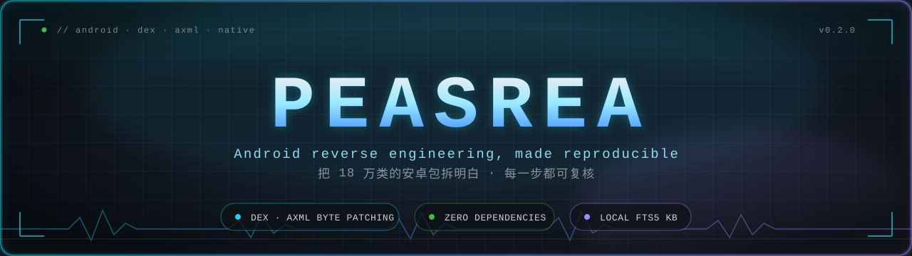

<div align="center">



### 把 18 万类的安卓包拆明白，每一步都能复核

**Reverse-engineer a 30-dex / 180k-class Android app — with coverage accounting, byte-level patches, and a searchable local knowledge base.**

<sub>不再“反编译一下看看”，而是把逆向做成可复现、可验证、可积累的工程流程。</sub>

<br />

[](https://github.com/Kirra47/peasrea/actions/workflows/ci.yml)
[](https://github.com/Kirra47/peasrea)
[](./LICENSE)
[](https://github.com/Kirra47/peasrea/stargazers)
[](https://github.com/Kirra47/peasrea/issues)
[](https://github.com/Kirra47/peasrea/releases)
[](./pyproject.toml)
[](#quick-start)

<br />

[✨ 核心特性](#features) · [🚀 快速开始](#quick-start) · [📸 效果演示](#demo) · [🛠️ 架构说明](#architecture) · [📚 知识库](#knowledge-base) · [🤝 致谢](#thanks)

</div>

---

<a name="why"></a>

## 💡 Why PeasRea?

逆向大型 App 时，真正拖时间的从来不是“怎么打开 APK”，而是这几件事：

| 痛点 | 传统做法 | PeasRea |
|---|---|---|
| **反编译到底覆盖了多少？** | “jadx 跑完了” → 其实跳过了所有 `ACC_SYNTHETIC` 类 | `coverage_check.py` 给真实口径：非 synthetic 顶层类覆盖率 **98.7%**（18 万类实测） |
| **改一个门控要重打包吗？** | apktool 重建 → 资源错乱、签名踩坑 | 字节级补丁：AXML 只改 `exported` 位、dex 只改立即数，**文件长度不变**，自动重算 checksum/SHA-1 |
| **结论怎么复核？** | “我看代码是这样的” | 每条结论带来源（`文件:行` / dex 偏移 / 证据 id），观察 / 推导 / 未知三态分开写 |
| **下次还得重来一遍？** | 笔记散落、聊天记录翻不到 | 本地 FTS5 知识库：**390 块 / 35 万字**，中文子串可查，一条命令追加新案例 |
| **依赖地狱** | 装 androguard、jadx、frida… 版本互相打架 | **零依赖**：全部工具只用 Python 3.9+ 标准库（SQLite 带 FTS5 即可） |

> 一句话：**别人给你一份反编译结果，PeasRea 给你一套可复现的证据链。**

---

<a name="features"></a>

## ✨ 核心特性

<table>
<tr>
<td width="50%" valign="top">

**🔬 覆盖率先行**

- `dex_index.py`：18 万类 / 1.1 万包，**< 1 秒**建索引
- `coverage_check.py`：区分 synthetic、内部类合并、默认包映射，给出**可引用的覆盖率数字**

**🧩 字节级补丁**

- `patch_manifest.py`：直接改二进制 AXML 的 `android:exported`
- `patch_dex.py`：改立即数 / 方法体，自动重算 `adler32` + `SHA-1`
- `rebuild_apk.py`：替换条目并剔除旧签名

</td>
<td width="50%" valign="top">

**🧠 可检索的知识库**

- SQLite **FTS5 + trigram**，中文可任意子串检索
- 多案例共用一套索引，`--case` 一键限定范围
- `kb_add_case.py` 把新报告并进来，CI 会检查索引是否过期

**🤖 技能形态**

- `SKILL.md` 七步流程 + 五条铁律，可被支持 skill 的 agent 直接加载
- 10 篇方法论 + 3 个 Frida 模板（字段 hook / 插桩接管 / 机型伪装）

</td>
</tr>
</table>

---

<a name="demo"></a>

## 📸 效果演示

<div align="center">

<!-- 把截图 / GIF 放进 assets/demo/，然后取消下一行注释并替换文件 -->
<!--  -->

```text
┌──────────────────────────────────────────────────────────────┐
│                                                              │
│   把运行截图 / GIF 放到 assets/demo/ 后取消上面的注释即可     │
│   suggested:  720p · 8–12s · 循环                            │
│                                                              │
└──────────────────────────────────────────────────────────────┘
```

</div>

一条命令看效果：

```bash
python peasrea.py info
# PeasRea 0.2.0
# kb      390 blocks / 2 cases
```

---

<a name="quick-start"></a>

## 🚀 快速开始（3 步）

```bash
# 1) 拿到仓库
git clone https://github.com/Kirra47/peasrea.git && cd peasrea

# 2) 查知识库（无需安装任何依赖，Python 3.9+ 即可）
python peasrea.py query 长连接 --top 3
python peasrea.py info

# 3) 对自己的 APK 跑一遍
python peasrea.py index   unpacked/dex --out dex-index
python peasrea.py coverage java/sources unpacked/dex --json cov.json
```

<details>
<summary><b>作为 agent 技能安装（可选）</b></summary>

```bash
# macOS / Linux
bash install.sh                  # → ~/.agents/skills/peasrea
# Windows
pwsh -File install.ps1           # → %USERPROFILE%\.agents\skills\peasrea
```

安装后支持 skill 的 agent 会在下次会话自动识别 `peasrea`，按七步流程工作。
</details>

<details>
<summary><b>安装成命令行（可选）</b></summary>

```bash
pip install -e .
peasrea info
peasrea query 导出组件 --case im-client-8.2.2.1
```
</details>

<a name="architecture"></a>

## 🛠️ 架构说明

```text
peasrea/
├── SKILL.md                 七步流程 + 五条铁律（技能入口）
├── peasrea.py               统一 CLI：info / query / kb-build / index / coverage / manifest
├── assets/
│   ├── banner.svg           本页封面
│   └── frida_*.js           3 个 Frida 模板（字段 hook / ISurgeon 接管 / 机型伪装）
├── references/              10 篇方法论
│   ├── 01-recon-container.md      容器、签名、清单、zip 异常扫描
│   ├── 02-decompile-index.md      全量反编译、覆盖率、dex 索引
│   ├── 03-resources.md            资源/ARSC、locale、品牌、raw/assets
│   ├── 04-native.md               ELF、加固识别、JNI 表重建、段表还原
│   ├── 05-security.md             安全栈、风控、检测清单
│   ├── 06-protocol.md             MTOP 签名、长连接帧、抓包可行性矩阵
│   ├── 07-patching-verify.md      三条补丁路线 + 真机验证 + 回滚
│   ├── 08-case-im-client.md       案例复盘：能做什么、不能做什么
│   ├── 09-ideas-log.md            想法台账（每条都标 ✅ / ⚠️ / ❌ 与依据）
│   ├── 10-toolchain-integration.md 与本机逆向工具链的协同
│   └── 11-h5-app-recon.md          H5/微应用侦察（零信任网关后的接口测绘）
├── scripts/                 10 个可复用工具（纯标准库）
├── tests/                   24 个用例 + 合成 AXML / dex 构造器
└── kb/                      知识库：cases/<case-id>/reports + kb.sqlite
```

**七步流程**（详见 `SKILL.md`）：

```text
容器与签名 → 全量反编译+覆盖率 → 资源与配置 → dex 索引 → native 层 → 安全栈与协议 → 补丁与验证
    01              02              03         02         04          05 / 06         07
```

<a name="scripts"></a>

### 🧰 脚本一览

| 脚本 | 用途 |
|---|---|
| `peasrea.py` | 统一入口：`info / query / kb-build / kb-add-case / index / coverage / manifest` |
| `coverage_check.py` | 真实口径的反编译覆盖率（区分 synthetic / 内部类 / 默认包） |
| `dex_index.py` | 轻量 dex 索引：类表、包统计、重复类（18 万类 < 1 秒） |
| `patch_manifest.py` | 二进制 AXML 直接改 `android:exported`（不重打包） |
| `patch_dex.py` | 常量级字节补丁，自动重算 checksum + SHA-1 |
| `rebuild_apk.py` | 替换条目 + 剔除旧签名 |
| `extract_surgeon_ids.py` | 从插桩样板里抽取 (方法, id) 映射表 |
| `kb_build.py` / `kb_add_case.py` / `kb_query.py` | 知识库构建 / 追加案例 / 检索 |
| `observe_readonly.sh` | 只读真机观测（不安装、不清数据、不点屏） |
| `h5_capture.py` | 一键配置/还原 H5 抓包（系统 CA + `adb reverse` + 代理） |
| `sanitize_capture.py` | 抓包脱敏：PII / token / 电话 / 邮箱 / 嵌套 JSON |

<a name="knowledge-base"></a>

## 📚 知识库

```bash
python peasrea.py query --stats         # 规模、按案例/来源统计
python peasrea.py query --cases         # 案例列表
python peasrea.py query "导出组件" --top 5
python peasrea.py query "ISurgeon" --case im-client-8.2.2.1
```

当前收录 **390 块 / 35 万字**：

- `im-client-8.2.2.1` —— 一次完整案例的 17 份报告（品牌、账号、密钥均已脱敏为占位符）
- `skill` —— 本仓库的方法论文档

追加自己的案例：

```bash
python peasrea.py kb-add-case --case my-app-1.0 --from analysis/ REPORT.md \
  --title "…" --version "1.0" --package com.example.app --sha256 <hash> --classes 12345
```

---

## ✅ 测试与 CI

```bash
pip install -r tests/requirements.txt
python -m pytest tests          # 24 passed
```

`tests/` 里带**合成样本构造器**（`axml_builder.py` / `dex_builder.py` / `dex_builder_methods.py`），
不依赖真实 APK 即可验证：`exported` 定点翻转、dex 字节补丁与校验和、类索引、覆盖率口径、知识库构建与中文检索、CLI 分发。

<table>
<tr><th>CI 任务</th><th>作用</th></tr>
<tr><td><code>python-checks</code> (3.10 / 3.12)</td><td>语法编译、SKILL.md frontmatter、知识库重建、CLI 冒烟</td></tr>
<tr><td><code>pytest</code> (3.10 / 3.12)</td><td>24 个用例</td></tr>
<tr><td><code>kb-staleness</code></td><td>重建后 <code>kb/index.md</code> 必须与提交一致（防止改了报告忘重建）</td></tr>
<tr><td><code>redaction-guard</code></td><td>全仓扫描品牌 / 密钥 / 个人信息，命中即失败</td></tr>
</table>

## 📦 发布

```bash
git tag -a v0.2.0 -m "PeasRea v0.2.0" && git push origin v0.2.0
```

推 tag 即自动打包 `peasrea-v0.2.0.zip` / `.tar.gz` 并附到 [Releases](https://github.com/Kirra47/peasrea/releases)。

---

<a name="thanks"></a>

## 🤝 致谢与使用边界

- 方法论来自一次真实的 30 dex / 180,864 类 / 152 个 `.so` 客户端逆向，报告已脱敏后以 `im-client-8.2.2.1` 收录。
- 感谢所有把逆向经验写成公开笔记的人——`references/` 里很多判读技巧都能在社区文章里找到源头。
- 本项目用于**自有应用或已获授权目标**的安全研究、兼容性分析与教学；使用者需自行确保行为合法合规。

**如果这套流程帮你省下了一个通宵，点个 ⭐ 就是最好的反馈。**

<a href="https://star-history.com/#Kirra47/peasrea&Date">
  
</a>

## 📄 License

[MIT](./LICENSE)
