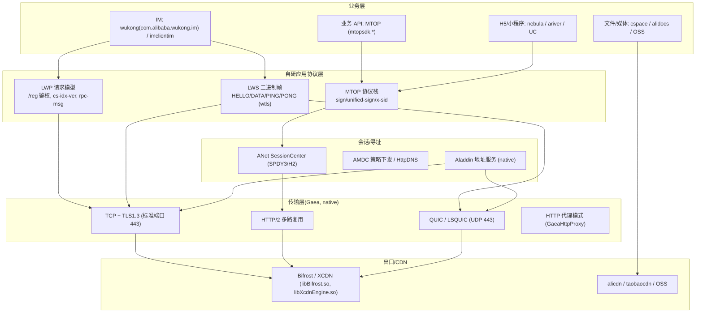

# IM 8.2.2.1 专属版 — 网络与协议分析（task-5 / net-analyst）

- 目标：`D:\Deepseek-Harness-workspace\re\base_apk3\target.apk` = IM 8.2.2.1 专属版 `<PKG>`，`MTOP_APPKEY=21811227`，`FLAVOR=enterprise`，`UA_2ND_TYPE=exclusive`
- 输入：`unpacked/dex`（30 dex）、`unpacked/assets`（1,148 文件）、`unpacked/native/lib/arm64-v8a`（152 个 .so）、lead 的全量 jadx 产物 `java/sources`（本轮读取时已生成 7 万+ 文件，覆盖到 classes30）
- 产物：本文件 + `scan/net/{endpoints.tsv, domains.txt, mtop-apis.tsv, protocol-notes.md}` + `scan/net/_tools/*`（可复现脚本）
- 记号：**[观察]** 代码/字符串可直接验证；**[推断]** 由命名/调用关系/常量推得；**[未知]** 静态不可判定（多为 native 内部）
- 既往报告（`re/imclient_mod/report/`）只作为线索，本文所有结论均在本包上重新取证；与其不一致处已在 §11 标注

---

## 1. 结论摘要

1. **网络栈是五层堆叠、两条腿走路**：MTOP（业务 API，HTTP 语义）与 LWS/LWP（自研长连接，二进制帧）并列；两者共用一个 native 传输层 Gaea（HTTP/2 + LSQUIC/UDP），并由 ANet/AMNet 提供会话、寻址（AMDC）、降级，Bifrost/XCDN 负责内容分发。
2. **MTOP 的 `sign` 不是纯 Java 能算的**：生产路径走 SecurityGuard（`signRequest(requestType=7)`）/ AVMP `mwua`；Java 层只有 **兜底 HMAC-SHA1** 实现，但它把 **签名原文（base string）的字段顺序完整暴露**了（§4.2）——这是本次最有价值的收获。
3. **设备身份四件套**：`utdid`（UT SDK）、`umid/x-umt`（SecurityGuard native）、`deviceId`（首次由 MTOP 系统接口申请并落 SP）、`appkey`（常量 21811227 + SG 静态数据存储）。`appSecret` 不在 Java 层。
4. **LWS 长连接协议已完整还原到字节级**：4 字节头（type/bodyLen/version/attrCount/cipherFlag）+ TLV 属性 + AEAD body；握手属性表、`/reg` 鉴权路径、4040 字节分片、seq 防重放、PING/PONG 保活、`REUSE_SID` 快重连都已取证（详见 `protocol-notes.md` §1）。
5. **握手用的服务端公钥是硬编码常量**（7 个 SNI：test/default/cdn1..cdn5，每个 32 字节），且可由 Gaea 配置下发轮换、也可被 URI 的 `pub-key=` 参数覆盖 —— 既是设计上的"可轮换 pin"，也是**注入点**。
6. **Java 层抓不到 Gaea 的明文**：`GaeaAladdinManager` 把 URL 交给 `com.imclient.gaea.jni`（native）出网，OkHttp/HttpURLConnection 只看到"本地代理式"调用。QUIC 走 LSQUIC（UDP/443），因此**普通 HTTP 代理抓包看不到长连接与 QUIC 流量**。
7. **端点面**：3,713 条（域名/URL/IP），去重后 **1,078 个域名**、**180 个真实 MTOP api 名**、**61 个 IP**（含 10 个内网/回环）。线上 594 / 预发 30 / 日常 39 / 内网 12（host 口径）。
8. **环境三元组（线上/预发/日常）在包里是齐的**：`lws-daily…?sni=test`、`lws-pre…`、`lws-sgunit…`、`pre-*.<host>`、`*.wapa.taobao.com`、`django.t.taobao.com`、`alibaba-inc.com` 内网域名全都在字符串里，且 `DevSettingActivity` 可运行时切换（见 03 任务），**客户端默认只消费服务端下发的环境**（MTOP 侧被启动任务固定 ONLINE）。
9. **登录会话**：扫码（`WebLoginActivityV2` + `qr.<host>`）、密码/免密、第三方 OAuth（`com.ali.user.open.oauth`）、运营商一键登录（`config2/rcs.cmpassport.com`）都在客户端；**多端登录/设备绑定是服务端策略**，客户端只展示 `MultiLoginActvity`（"你已在其他设备登录"）；Cookie 通过 IDL 服务 `CookiesIService`/`CookieModel` 管理，Token 主要落在 SG/UT 与 SP（键名清单见 §9.4）。
10. **最大未知**集中在 native：LWS 会话密钥 KDF、`CIPHER_SUITE=0` 具体算法、AMDC 报文结构、wua 生成算法。

---

## 2. 分层全景



要点（**观察**）：
- `com/laiwang/protocol/android/lws/LwsConnection` 只依赖 `lwp.Connection` 抽象，实际传输由 `NioConnection`（TCP）或 `lwp/quic`、`lwp/gaea`、`lwp/http2lwp` 提供 ⇒ **同一套 LWS 帧可跑在 TCP/QUIC/H2 之上**。
- `com/laiwang/protocol/android/lwp/GaeaTransmission` 是 Gaea 的 Java 门面；`GaeaAladdinManager` 通过 `com.imclient.gaea.jni.*` 把 URL 交给 native。
- `anet/channel/*` 属于淘宝 ANet（SPDY3/HTTP2），与 LWS 栈**并存**：MTOP/图片/UT 等走 ANet，IM 长连接走 LWP/LWS。

---

## 3. 端点清单与分类

数据：`scan/net/endpoints.tsv`（3,713 行：host 675 / url 2,977 / ip 61）、`scan/net/domains.txt`（1,078 域名）、`scan/net/mtop-apis.tsv`（180 个 api 名）。
脚本：`scan/net/_tools/extract_strings.py`（dex 字符串表 + assets 文本 + .so 二进制三路抽取）、`classify.py`（去噪 + 环境 + 用途）、`extract_apis.py`（MTOP api 名）。

### 3.1 环境分布（host 口径，**观察**）

| 环境 | host 数 | 判定依据（示例） |
|---|---|---|
| online | 594 | 默认 |
| daily/测试 | 39 | `*.wapa.taobao.com`、`*.waptest.taobao.com`、`django.t.taobao.com`、`daily-*.<host>`、`test.alipay.net`、`sandbox.xmpush.xiaomi.com`、`test.xquic.com` |
| pre/预发 | 30 | `pre-*.<host>`、`preview.<host>`、`*-pre.alicdn.com`、`orange-*-pre.*`、`pre-hpweb.alipay.com` |
| internal 内网 | 12 | `*.alibaba-inc.com`、`*.alibaba.net`、`amdc.taobao.net`、`dd.alibaba.net`、`orange-*-daily.alibaba.net` |

### 3.2 用途分类（host 口径，**观察+推断**）

| 用途 | 数量 | 代表端点 |
|---|---|---|
| media/doc/CDN 静态 | 67 + 22 | `gw.alicdn.com`、`img.alicdn.com`、`down-cdn.<host>`、`img01..07.taobaocdn.com`、`cube.elemecdn.com` |
| pay（支付宝侧） | 69 | `alipay.com`、`mapi.alipay.com`、`gw.alipayobjects.com`、`tfs.alipayobjects.com` |
| mail/calendar | 26 | `alimei-api.alibaba.com`、`alimei-content`、`webmail.alibaba-inc.com`（内网） |
| tracking | 25 | `adashx.ut.<host>`、`h-adashx.ut.taobao.com`、`gm.mmstat.com`、`beacon-api.aliyuncs.com`、`adash-emas.cn-hangzhou.aliyuncs.com` |
| accs 通道（推送/长连接注册） | 19 | `acs.m.taobao.com`、`acs.wapa.taobao.com`(daily)、`amdc.m.taobao.com`、`msgacs/umsgacs/trade-acs/guide-acs` |
| api gateway | 17 | `m.taobao.com`、`m.<host>`、`api.django.t.taobao.com`(daily)、`api-daily.django.alibaba.net`(内网) |
| site portal | 16 | `www.<host>`、`t.<host>`、`taobao.com`、`alibaba.com` |
| **live-longconn** | **9** | 见 3.3 |
| login/oauth | 9 | `login.<host>`、`oauth.m.taobao.com`、`login.m.taobao.com`、`login.tmall.com`、`auth.wosms.cn`、`config2/rcs.cmpassport.com` |
| doc/cspace | 7 | `alidocs.<host>`、`docs.<host>`、`pre-taoyuan.wopi.<host>`（WOPI 文档协作） |
| map/lbs | 8 | `*.amap.com`（AMapSDK v8.1.0） |
| biz portal | 10 | `attend.<host>`、`oa.<host>`、`tms.<host>`、`space.<host>`、`h5.<host>` |
| qr/deeplink | 3 | `qr.<host>`（深链/设置页/扫码统一入口） |
| appcenter/update | 3 | `appcenter.<host>`、`down.<host>`、`pre-down.<host>` |
| push（厂商） | 3 | 小米/OPPO/vivo 通道域名 |
| security | 2 | `resolver.msg.xiaomi.net` 之外的 SG/UMID 相关 |
| open platform | 2 | `open.<host>`、`open-drp.<host>` |
| rtc/teleconf | 3 | `grtn`/`voip`/`alivideolive` 系 |
| 未分类 | 343 | 多为业务 H5 域名（保留在 TSV 中，未强行归桶） |

### 3.3 长连接 / 推送通道端点（**观察**，字符串直出）

| 端点 | 环境 | 说明 |
|---|---|---|
| `lws://lws.<host>:443` | online | LWS 主通道（`ExtensionImpl.java:255`、`x2b.java:142` 的 `defaultMainAddr`） |
| `lws://quic.<host>:443` | online | QUIC 主通道（`Extension.defaultQuicURI()`） |
| `lws://lws-eos.<host>` | online | SLAVER_DOMAIN（第二站点，专有/EOS 集群） **[推断]** |
| `backup.{lws,quic,tls,udp,http}.<host>` | online | 五条备份通道（`GaeaAladdinManager.UriDomain`） |
| `lws://lws-daily.<host>:443?sni=test` | daily | 日常；`sni=test` 选 `ServerPubKey.TEST` |
| `lws://lws-short-daily.<host>:7000?sni=test` | daily | 短连接/备用端口 7000 + sni=test |
| `lws://lws-pre.<host>:443`、`lws://lws-short-pre-dr.<host>:443`、`lws://pre-quic.<host>:443` | pre | 预发（含 DR 容灾） |
| `lws://lws-sgunit.<host>`、`lws://lws-sg-short.<host>` | online | 新加坡集群（sg=Singapore）**[推断]** |
| `lws://lws.laiwang.com` | online | 老域名（来往），兼容保留 |
| `acs.m.taobao.com` / `*.wapa` / `*.waptest` / `amdc.*` | online+daily | ACCS 通道注册与策略下发（推送/长连接注册） |

### 3.4 内网与特殊 IP（**观察**）

```
127.0.0.1(8)  10.0.0.200(3)  10.0.0.172(2)  192.168.43.255(2)  10.38.162.35  10.8.53.4
172.16.0.1    172.30.1.1    100.67.1.4    100.67.64.54
```
- `10.0.0.172` = **中国移动 CMWAP 代理网关**（`10.0.0.172:80`），说明包内带有 APN/代理探测逻辑 **[推断，高置信]**。
- `192.168.43.255` = Android 热点网段广播地址（常见于网络状态判断）。
- `10.20.171.217/WebLogManagerTest/Home/UploadFile`（在 URL 桶）= 内网日志测试服务 **[观察]**。
- 另有 2 个公网 DNS `223.5.5.5`（AliDNS）、`114.114.114.114`；`203.119.244.129-197` = 阿里 CDN 节点段（32 条，来自 .so/配置） **[推断]**。
- 证书类误报（ASN.1 OID `2.5.29.x`、`1.3.36.x`）已从 `endpoints.tsv` 剔除，剔除清单见 `scan/net/_tools/dropped.txt`。

### 3.5 MTOP api 名（180 条，**观察**）

集中在支付宝/阿里系 SDK 侧（`alipay.*` 97 条）、文件/媒体 15 条、登录鉴权 12 条，另有IM自有前缀（`imclient.*`）少量。样例：

```
alipay.bic.silence.doRegister          alipay.cdp.space.feedback
alipay.acquire.page.createandpay      mtop.alibaba.ccrc.sdk.heartbeat      (风控 SDK 心跳)
mtop.taobao.powermsg.msg.subscribe    (消息订阅)   mtop.alibaba.ucc.bind.identify  (账号绑定)
alibaba.security.deepvision.devicemanager.getlicense / getauthkey              (安全设备指纹)
alibaba.aliqin.ta.pns.living.create   (阿里大于/短信-直播)
```
> 说明：MTOP 的 **IM业务 api 名多用 `imclient.` 前缀且经插件/动态下发**，静态字符串里只有一部分；完整列表需动态抓取请求的 `api=` 参数（及 `x-api` 类头，若存在）或从下发配置取。

---

## 4. MTOP 层

### 4.1 请求构造 **[观察]** `mtopsdk/mtop/protocol/{builder,converter}/impl/*`

- `InnerProtocolParamBuilderImpl` 组装 query（`api/v/data/utdid/ttid/deviceId/...`）与 header；
- `InnerNetworkConverter` 负责把 sign 结果塞进 header（映射表 `X_SID→"sid"`, `X_APPKEY→"appKey"`, `X_SIGN→"sign"`, `X_UMID_TOKEN→KEY_UMID_TOKEN`）；
- 编码：`FORM_CONTENT_TYPE=application/x-www-form-urlencoded;charset=UTF-8`；`x-bin-length` + `x-exttype` 用于二进制扩展体；`content-encoding: gzip`。
- 请求体加密：MTOP 标准是 **`data` 参数整体加密（SG 提供的 `getSecBodyDataEx`/`x-open-biz-data`）**；本包未见固定密钥的 Java 侧自定义加密 **[推断]**；二进制大包走 `x-bin-length` 分包/`uploadStats`。

### 4.2 sign 算法与参与字段 **[观察，关键]**

签名原文（`Input`）按固定顺序用 `&` 连接：

```
utdid & uid & reqbiz-ext & appKey & urlencode(data) & t & api & v &
sid & ttid & deviceId & lat & lng & [extdata] & x-features &
routerId & placeId & open-biz & mini-appkey & req-appkey & accessToken & open-biz-data
```

- 计算：`SecurityGuardManager.getSecureSignatureComp().signRequest(ctx{appKey, requestType=7, paramMap={INPUT:baseString}}, authCode)`；
  HMAC-SHA1 变体用 `requestType=3`；`getSign()` 走安全中间件（`IMiddleTierGenericComponent.getSign`），可返回 `x-sign` + 额外头（`x-mini-wua` 等）；
  设备指纹走 AVMP：`createAVMPInstance("mwua","sgcipher").invokeAVMP("sign", …)`。
- **Java 兜底实现**：`mtopsdk/security/b.java`（`LocalInnerSignImpl`）`stb.b(baseString, appSecret)` = HMAC-SHA1；`SwitchConfig.getUseSecurityAdapter()&1` 才尝试中间件，否则直接走 SG。
- 测试环境标记：`b()==2` 时注入 `ATLAS=daily`（日常环境）。

### 4.3 关键头 **[观察]**（完整清单见 `protocol-notes.md` §3.3）

`x-appkey x-ttid x-umt x-sid x-sign x-systime x-uid x-devid x-mini-wua x-features x-pv x-t x-nq x-nettype x-page-url x-place-id x-router-id x-reqbiz-ext x-open-biz x-extdata eagleeye-traceid mtop-xetag …`

### 4.4 关键类（混淆名 → 角色）

| 类 | 角色 |
|---|---|
| `mtopsdk.mtop.intf.Mtop` / `mtopsdk.mtop.global.MtopConfig` | 实例与全局配置（appkey/env/context） |
| `defpackage.lto`（`Mtop.instance(null,ctx)` 封装） | 应用侧 MTOP 引导；`f(ctx)` 判定 `EnvModeEnum.ONLINE` |
| `defpackage.sk0`（`AppConfigManager`） | 下发 appConf/apiCacheConf，持久化到 `externalFilesDir/mtop` |
| `mtopsdk.mtop.deviceid.DeviceIDManager` | deviceId 申请/落盘（`MTOPSDK_DEVICEID_STORE.<appkey>`） |
| `mtopsdk.mtop.protocol.builder.impl.InnerProtocolParamBuilderImpl` | 参数与头组装、sign 注入 |
| `mtopsdk.mtop.protocol.converter.impl.InnerNetworkConverter` | 头映射与网络请求转换 |
| `mtopsdk.security.a`（`InnerSignImpl`）/ `b`（`LocalInnerSignImpl`） | 签名（SG / 本地兜底） |
| `defpackage.xo`（`BaseSignImpl`） | ISign 抽象基类 |

---

## 5. Gaea / QUIC / Bifrost-XCDN

### 5.1 Gaea 初始化 **观察**（`defpackage/x2b.java:117-200`）

`defaultMainAddr=lws://lws.<host>:443`、`defaultDomain=lws.<host>`、`smartHeartbeatEnable=true`、`rpcTimeoutHeartbeatDetect=true`、`masterConnectionDisableOpt=true`、`appBoostrapInitOpt=true`；`appKey`/`deviceId` 取自 `Extension.getCacheHeaders()` 的 `app-key`/`did`；文件通道池 4（huge 3）、上传 frag 重试 5 次、超时 120–180s；`proxyInfo` 支持 HTTP 代理（专网/XPN 场景）。

### 5.2 出网方式 **观察 + 推断**

- `com/imclient/gaea/jni/GaeaHttpProxyInfo/GaeaHttpProxyStartCallback` ⇒ Gaea 以 **本地代理** 形态接管 Java 侧请求；
- `libgaea.so`（9.2MB）、`liblsquic.so`、`libxquic`、`libBifrost.so`、`libXcdnEngine.so` 提供 UDP/QUIC 与内容加速；
- 因此：**HTTP 抓包（mitmproxy/Charles）只能看到 Java 侧未交给 Gaea 的请求**；QUIC 与长连接需要 UDP 层或 hook。

### 5.3 Aladdin 动态地址 **[观察]**

`GaeaAladdinManager`（classes21）通过 native `AladdinNative` 维护 8 类站点（§protocol-notes 5），回调 `onRouteRefresh(url)`、`onRouteNotify(ok,is429)`、`onForceUpdateUri(UriOpen)`；`UserOpen{uid, orgId}` 参与选址 ⇒ **同一账号+组织会被路由到特定接入点**（专属IM的多租户集群路由）。**[推断]**

### 5.4 Bifrost / XCDN

`com/alipay/bifrost/*`、`com/alipay/mobile/common/amnet/bifrost/*`、`com/youku/phone/xcdn/*` + `libBifrost.so`/`libXcdnEngine.so`；用于大文件/媒体分片、P2P 加速与 CDN 调度 **[推断]**。

---

## 6. LWS / LWP 长连接与 IM 衔接

> 字节级细节见 `scan/net/protocol-notes.md` §1、§2。此处给结论与链路。

### 6.1 握手（**观察**）

1. 取 URI：`lws://<host>:<port>?sni=<name>`，可选 `pub-key=<hex>`；
2. `LwsConnection.q()` 解析 `sni`（缺省 `default`），`ServerPubKeyManager.c(sni)` 取服务端公钥（SP `LWS_PUB_<sni>` → 内置枚举 → 失败 `onUriInvalid`）；
3. UA = `<prefix>/a<version>`；`VIA` = `<host>:<port>`；
4. `ClientCodec` 构造出 `HELLO_REQUEST`（属性见 §1.2），`cipherFlag=1`（明文）发出；
5. 收 `HELLO_RESPONSE`（可能加密）：`RESULT / EXPIRE / SESSION_ID / SIGN`，回调 `onHandShakeDone(sessionId, expire, sign, key?)`；
6. 失败/过期触发 `onReAuth` / `refreshSession` / `onSessionExpire`。

### 6.2 鉴权与会话续期

- HTTP 侧注册：`Extension.authUri()="/reg"` **[观察]** ⇒ 首次/续期通过 LWS 主机上的 `/reg` 换取 token（服务端决定有效期）。
- 复用：`REUSE_SID` + `lws/a.C1968a{sid,key}` 缓存，重连只做增量握手（日志：`lws handshake sid <hash>`）。
- 心跳：`HEART_BEAT` + AlarmManager 广播（后台）+ `SmartHeartBeatInterval` 自适应；协议层 PING/PONG。

### 6.3 上行/下行与 IM 的衔接

- 链路：`wukong IM (com.alibaba.wukong.im)` → `com.laiwang.protocol.android.LWP`（`Transmission`/`LwpRequestConnection`）→ `LWS DATA` 帧 → Gaea TCP/QUIC。
- `defpackage/uce.java implements com.laiwang.protocol.android.agent.Agent`（Logout/Reset 监听）、`defpackage/g51.java extends LwpRequestConnection implements BackupConnection`（降级连接）、`defpackage/vy3`/`kom` 实现 `LwsListener`/`LwsSession` 消费。
- LWP 请求头语义（观察）：`stream`/`stream-id`（流式消息）、`rpc-msg`/`rpc-msg-id`（RPC over 长连接）、`cs-idx-ver`/`cs-idx-url`/`fc-v2-idx-data`（会话索引/增量同步游标）。
- **IM 业务帧（`DATA` body）的具体序列化**（wukong 的 `Marshal`/msgpack-lite：`com/laiwang/idl/Marshal`、`com/laiwang/idl/msgpacklite`）在长连接之上再做一层编解码；本次只取证到 IDL 框架，**未逐字段还原**。**[部分未知]**

### 6.4 结论

- 长连接**不是 WebSocket**：是私有二进制协议直接跑在 TCP/443 或 QUIC/443 上（`lws://` 是自定义 scheme，不是 `ws://`）。
- 加密**双层**：TLS（传输层）+ 应用层 AEAD（`StreamCipher`，密钥来自握手）；即使绕过 TLS pinning，**仍拿不到应用层明文**，必须 hook `ClientCodec` 拿解密后数据。

---

## 7. 推送通道

| 通道 | 证据 | 客户端行为 |
|---|---|---|
| LWS 自建长连接 | LWS/LWP 栈 | 主通道：在线即走长连接，收到后由 `com/alibaba/wukong/idl/push` 解析 |
| ACCS | `acs.m.taobao.com`、`channel-acs`、`msgacs`、`umsgacs`（均有 wapa/waptest 日常版） | 通道注册/令牌下发（阿里统一通道服务） |
| HMS | `com/huawei/hms/*` | 华为设备注册 token |
| 小米 | `com/xiaomi/mipush`、`com/xiaomi/channel`、`com/xiaomi/mcssdk`、`sandbox.xmpush.xiaomi.com` | MIUI 通道，日常环境有 sandbox 域名 |
| OPPO/一加 | `com/heytap/msp/push`；`BuildConfig.OPPO_APP_SECRET` | ColorOS 通道 |
| vivo | `com/vivo/push` | FuntouchOS 通道 |
| 荣耀 / FCM | `com/alibaba/laiwang/xpn/honor/HonorPushChannel`、`.../fcm/FCMChannel` | XPN 统一封装；`SUPPORT_FCM=false` |
| 统一抽象 | `com/alibaba/laiwang/xpn/utils/BasePushChannel`（SP 键 `xpn_key_app_secret_<type>`） | 各厂商 token/secret 的本地存储 |

**XPN（专属网络）** 是本包特色：`com/alibaba/laiwang/xpn/*` + `com/alibaba/android/<pkg>/exclusive/xpn_guide/*`（Huawei/OPPO/VIVO/Xiaomi 各自的引导页）+ `biz/xpn/sync/NotificationInstructModel` ⇒ 专属IM要求用户把厂商推送的"自启动/后台保活"打开，否则长连接会被杀。**[观察+推断]**

---

## 8. 登录与会话

### 8.1 登录形态（**观察**，`com/alibaba/android/user/login/*`）

| 形态 | 客户端落点 | 端点 |
|---|---|---|
| 扫码登录（Web 端扫） | `com/alibaba/android/user/qrcode/WebLoginActivityV2`（`tryBindQrcode`, `startCountDown`）、`PageState` | `qr.<host>`、`login.<host>` |
| 密码/免密 | `SignUpWithPwdActivity`、`NoPwdLoginActivity`、`SendMsmVerifyV2Activity` | `login.<host>` |
| 组织域名登录 | `SignUpWithOrgDomainActivity` + `biz/realm`（realm 选择） | 租户自定义域（运行时下发） |
| 免登/SSO | `LoginInterfaceImpl`、`com.ali.user.open.oauth.*`（`OauthService`/`AppCredential`/`alipay3.SignRequest`） | `oauth.m.taobao.com/authorize`、`login.m.taobao.com/minisdk/login.htm` |
| 运营商一键登录 | `config2.cmpassport.com`、`rcs.cmpassport.com`（中国移动认证） | 运营商 |
| 第三方（IM扫码给三方） | `wss://openchannel.alipay.com/group/connect/`、`imobilegmp.alipay.com` | 小程序调试/开放通道 |

### 8.2 Token / Cookie（**观察 + 部分未知**）

- **Cookie**：`com/alibaba/android/user/idl/services/CookiesIService` + `com/alibaba/android/imclient/userbase/idl/CookieModel{values,expires,path,domain,secure}`，实现 `defpackage.vo5`（`CookieAPI`），小程序侧另有 `com/alibaba/lightapp/runtime/idl/CookiesIService`（safeTunnel）。
  ⇒ Cookie **不是** `CookieManager` 明文文件，而是通过 IDL 服务在进程间传递 + 由服务持久化。**[推断：持久化后端为 DB/SP，本次未定位到具体表名 → 未知]**
- **x-sid（MTOP 会话）**：由服务端登录接口返回，注入 `x-sid` 头（`InnerNetworkConverter` 映射 `X_SID→"sid"`）；本地保存位置在 SG/UT/SP 三者之一，`pre_login_has_token` 等 SP 键可见登录态痕迹（`sp_key_pre_login_has_token`）**[观察键名，存储值加密 → 未知]**。
- **LWS 会话**：`LwsSession{id,aesKey,expire,version}`，进程内 + `lws/a.C1968a` 缓存，`REUSE_SID` 持久化（跨重启快重连）。
- **设备身份**：见 §4.4（utdid/umid/deviceId）。

### 8.3 设备绑定 / 多端登录（**关键边界**）

- 客户端只有 **消费侧**：`MultiLoginActvity`（"账号在其他设备登录"）、`ReportLossActivity`（挂失）、`LoginErrorHandler`（错误码分发）、`user/device`、`user/alphaDevice` 包。
- 判定与踢下线 **全部是服务端策略**：客户端收到 `401/`特定错误码或长连接下发的 `KICKOUT` 控制帧后清理本地态并跳转（`ResetListener`/`notifyAccountRequired` 在 `lwp/Transmission` 中出现）**[观察调用点 + 推断语义]**。
- 设备上限、同端互斥、可信设备（`sp_key_get_device_status_from_local_or_rpc`）都由 RPC 查询 ⇒ **客户端不可信，也无法在本地"绕过"多端限制**（除非改服务端）。

---

## 9. 抓包与复现建议

### 9.1 为什么"抓不到"

| 障碍 | 机制 | 证据 |
|---|---|---|
| TLS pinning | 自有 pin（非 NSC）；`mtopsdk`/Gaea 自带校验 | 03 任务；`libgaea.so` 字符串含 `ssl.com`/`entrust.net` 根 |
| 私有二进制长连接 | LWS 帧 + 应用层 AEAD，非 HTTP | §6，`StreamCipher` |
| QUIC/UDP 443 | LSQUIC，绕开 HTTP 代理 | `liblsquic.so`、`quic.<host>` |
| native 出网 | Gaea 本地代理，Java 侧看不到 TLS 明文 | `GaeaAladdinManager`、`com.imclient.gaea.jni.*` |
| 设备指纹门控 | `x-sign`/wua 与 utdid/umid 绑定，改包即 4xx | §4.2 |
| 证书校验失败即拒 | `ServerPubKeyManager` 取不到公钥 → `onUriInvalid` | §6.1 |

**能抓到什么**：Java 侧 OkHttp/`HttpURLConnection` 的请求（图片、部分 H5、UT 埋点）、WebView 流量（若开调试）、`/reg` 之外的明文探测。
**抓不到什么**：MTOP 主业务（Gaea native + sign）、IM 长连接正文、QUIC。

### 9.2 推荐路线（从易到难）

1. **Java 层 hook（最快）**：`ClientCodec.c()` 拿解密后 LWS 帧；`ISign.getUnifiedSign`/`getMtopApiSign` 拿 sign 与头；`InnerProtocolParamBuilderImpl` 拿完整参数表。
2. **系统代理 + 用户 CA**：只能覆盖未走 Gaea 的请求；需确认 NSC（03 报告：无 `domain-config`、`cleartextTrafficPermitted` 见 manifest）——**预期大部分业务流量不经过**。
3. **UDP/QUIC 侧**：tcpdump/PCAPdroid 抓 443/UDP，但需 native 侧密钥才能解 ⇒ 实际不可行，除非 hook `lsquic` 的 `SSL_CTX`/`quic_conn` 导出密钥。
4. **Gaea 层**：hook `com.imclient.gaea.jni.GaeaHttpProxyStartCallback`/`AladdinDelegateOpen` 拿到 native 侧 URL、状态码、耗时（**能看到"发了什么 URL"，看不到 body**）。
5. **透明代理 + 关 pin**：仅当你已能改包（重签名/`frida` 挂 `SSLContext`）时可行；改包会破坏 `x-sign`（sign 覆盖 `data`），需同时 hook 签名。

### 9.3 现成 hook 点清单

```
com.laiwang.protocol.android.lws.ClientCodec#c(ByteBuffer, CodecListener)     // LWS 解密后的明文帧
com.laiwang.protocol.android.lws.LwsConnection#r(Connection)                  // 握手（含 sni/pub-key）
com.laiwang.protocol.android.lws.ServerPubKeyManager#c(String)                // 服务端公钥（可替换）
com.laiwang.protocol.android.lws.ClientCodec#onHandShakeDone(byte[],long,byte[],byte[])
com.laiwang.protocol.gaea.GaeaAladdinManager$b#get(String,HttpInterfaceCallbackOpen)  // native 出网 URL
mtopsdk.security.a#e(Map,String,boolean)                                      // sign base string
mtopsdk.security.a#getUnifiedSign / getMtopApiSign                            // sign 与附加头
mtopsdk.security.a#getAvmpSign / getSecBodyDataEx                             // wua / 加密体
mtopsdk.mtop.protocol.converter.impl.InnerNetworkConverter                    // 头注入点
anet.channel.SessionCenter#switchEnvironment(ENV)                             // 环境切换
com.alibaba.android.user.service.ExtensionImpl（LWS/OAUTH/媒体域覆盖）          // 端点劫持点
```

---

## 10. 环境切换与"专属"定制的网络含义

- `DevSettingActivity` 可写 `_LWS_URL / _LWS_QUIC_URL / _LWS_SHORT_URL / _OAUTH_URL / _ALADDIN_URL / _MEDIA_ID_DOMAIN / _MAIL_URL_* / _ALIPAY_CALLBACK` 等键，并通过 `ExtensionImpl` + `ACTION_DEBUG_ENV_CHANGE` 广播生效（详见 03 任务与本轮 `ExtensionImpl.java:255`）⇒ **运行时可以把长连接/鉴权/静态资源整体指向内网或自建服务器**。
- 但 **MTOP 网关被启动任务固定 ONLINE**（`defpackage/lto.f()` 判定 `EnvModeEnum.ONLINE`），因此切日常/预发时"部分通道仍走线上"——这与 03 报告观察一致，本轮在代码侧确认。

---

## 11. 与既往报告的差异 / 复核结论

| 既往说法 | 本轮结论 |
|---|---|
| "414 个域名" | 本轮三路抽取（dex+assets+so）得 **1,078 域名 / 3,713 行**；差异来自 assets 与 .so（既往只扫 dex） |
| "LWS 长连接" | 确认并**给出了字节级帧格式与握手属性表**（既往未展开） |
| "MTOP appkey 21811227" | 确认（`BuildConfig` + `defpackage/l1r.f52735a`），并补出 **appKey 亦可从 SG 静态数据存储按 index 取** |
| "Gaea/QUIC/LWS 为自研长连接体系" | 细化：Gaea=native 传输 + 本地代理；QUIC 走 LSQUIC；LWS 帧可跑在 TCP/QUIC/H2 三种传输上 |
| "无 `<domain-config>`，无 pinning" | 与 03 报告一致；但 **LWS 有应用层自带的服务端公钥 pin**（本次新发现），HTTP 侧待 03 动态验证 |

---

## 12. 未解项（明确标注）

1. LWS 会话密钥派生（KDF/算法标识）——在 `libkaliumjni.so`。
2. `CIPHER_SUITE=0` 的算法族与 AAD 构造。
3. `appSecret`（MTOP HMAC 兜底签名密钥）——SG 静态数据存储/native。
4. AMDC 下发报文字段级结构（`StrategyEntity` 只到解析层）。
5. IM `DATA` body（wukong IDL）字段级还原。
6. Cookie/Token 的最终落盘表名与加密方式（IDL 服务实现被 Surgeon 插桩/在别的 dex）。
7. 专属IM的租户域（realm）在登录时如何拼装请求（`biz/realm` 只看到选择 UI 与调用点）。

---

## 13. 产物清单

| 文件 | 内容 |
|---|---|
| `scan/net/endpoints.tsv` | 3,713 行：`endpoint / kind / env / purpose / hits / sources`（含 dex 名、asset 路径、.so 名） |
| `scan/net/domains.txt` | 1,078 个去重域名 |
| `scan/net/mtop-apis.tsv` | 180 个 MTOP api 名 + 分类 + 来源 dex |
| `scan/net/protocol-notes.md` | 协议字节布局、常量、SP 键、hook 点 |
| `scan/net/raw_hits.tsv` | 10,303 条原始命中（未去噪，可复算） |
| `scan/net/_tools/{extract_strings,extract_apis,classify}.py` | 可复现脚本（只读 `unpacked/`） |
| `scan/net/_tools/dropped.txt` | 1,635 条被剔除的噪声（含剔除原因可回查） |
